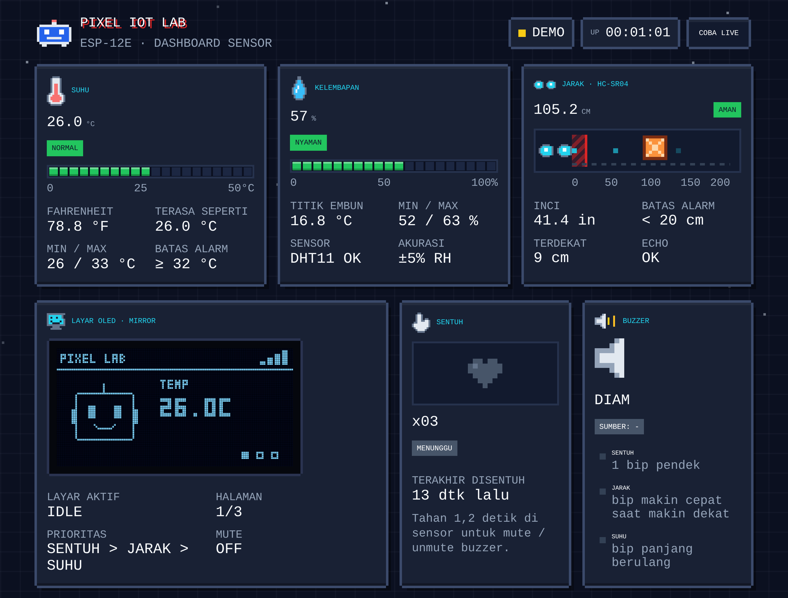
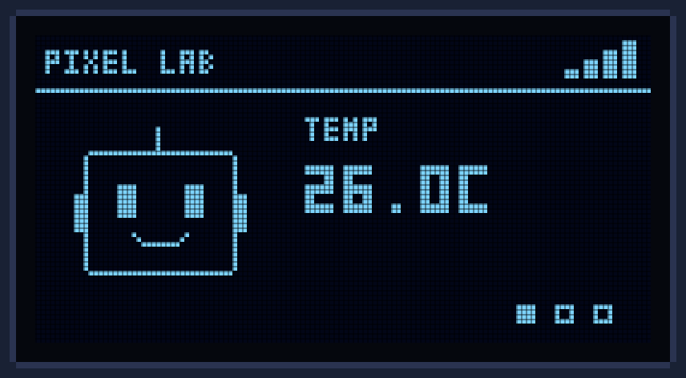
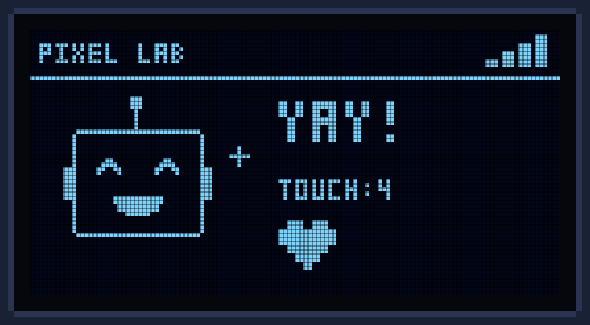
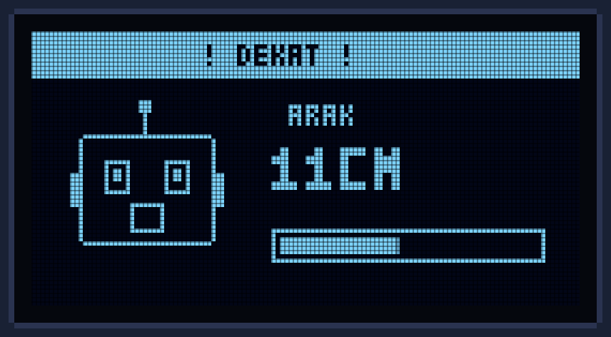
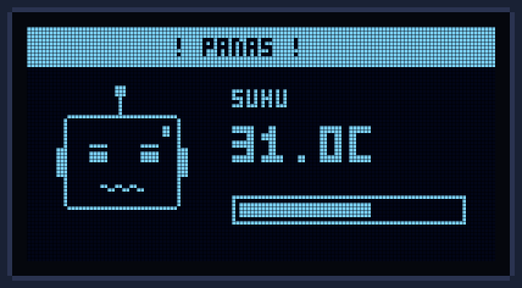
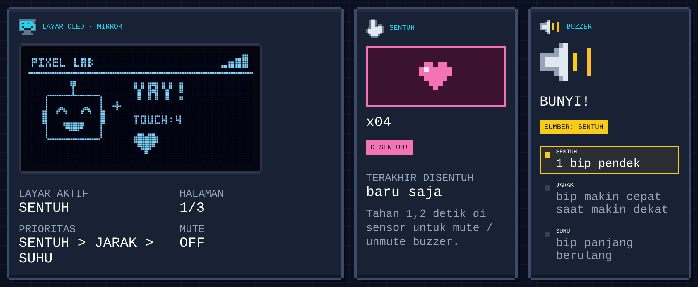
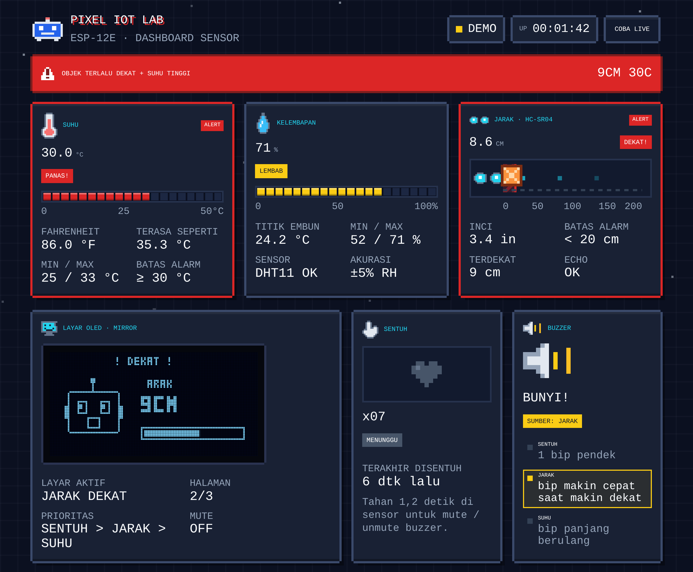
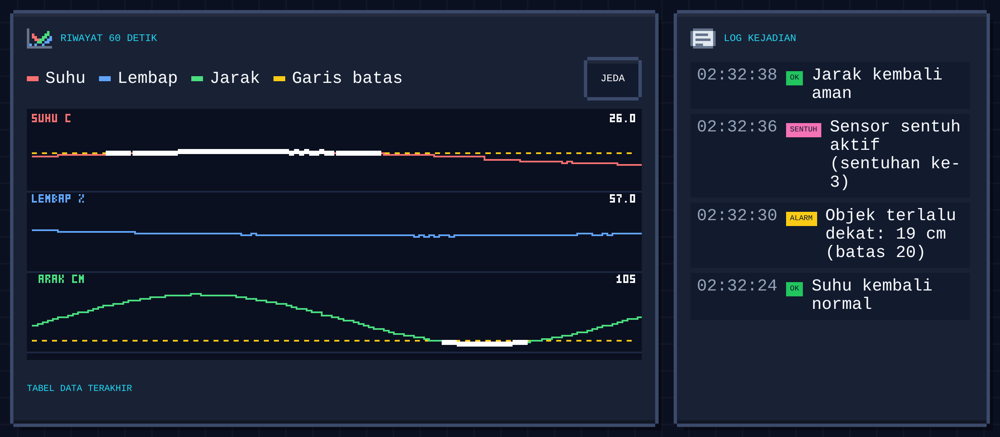
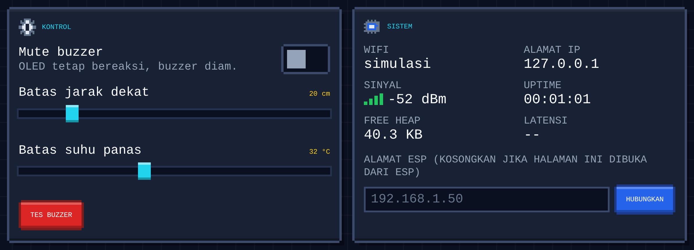
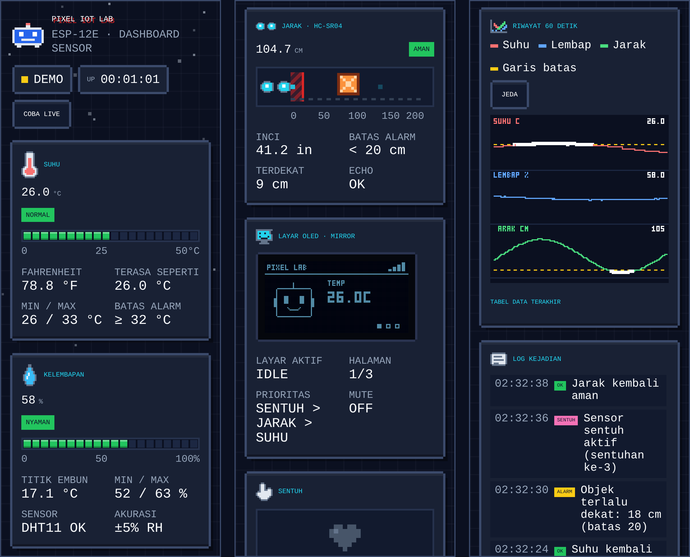

# Pixel IoT Lab

Dashboard sensor bergaya pixel art untuk ESP-12E (ESP8266). ESP membaca suhu, kelembapan, jarak, dan sentuhan, menampilkannya di layar OLED, membunyikan buzzer saat ada sensor yang aktif, dan menyajikan dashboard web lewat WiFi. Halaman web disimpan di flash ESP, jadi proyek ini tidak butuh server atau cloud.

Proyek ini dibuat untuk belajar dasar-dasar IoT.



<sub>Mode demo dengan data simulasi. Screenshot diambil tanpa akses ke Google Fonts, jadi teks HTML memakai font cadangan. Di browser yang online, judul dan label tampil dengan font Press Start 2P dan VT323.</sub>

## Komponen

| Komponen | Keterangan |
|---|---|
| ESP-12E | Misalnya papan NodeMCU 1.0 |
| HC-SR04 | Sensor jarak ultrasonik |
| DHT11 | Sensor suhu dan kelembapan |
| Sensor sentuh | Modul digital, misalnya TTP223 |
| OLED SSD1306 | 128x64 piksel, antarmuka I2C |
| Buzzer | Buzzer aktif. Buzzer pasif juga bisa lewat satu pengaturan di sketch |

## Cara kerja

Sketch membaca sensor di loop utama: sentuhan di setiap putaran, jarak tiap 120 ms (median dari tiga pembacaan), dan DHT11 tiap 2 detik. Hasilnya dipakai untuk menggambar layar OLED hingga 15 kali per detik, menentukan pola bunyi buzzer, dan mengisi endpoint JSON `/api/data`. Dashboard di browser memanggil endpoint itu sekitar dua kali per detik. OLED dan buzzer bereaksi langsung di perangkat, jadi tetap jalan walau tidak ada browser yang terbuka.

## Perilaku

| Kondisi | Layar OLED | Buzzer |
|---|---|---|
| Tidak ada yang aktif | Maskot berkedip. Suhu, kelembapan, dan jarak bergantian tiap 2,5 detik. | Diam |
| Sensor sentuh disentuh | Maskot tersenyum, tulisan YAY!, jumlah sentuhan, dan hati. | 2 bip pendek |
| Jarak di bawah batas (default 20 cm) | "! DEKAT !" berkedip, maskot ketakutan, bar jarak. | Bip makin rapat saat objek makin dekat |
| Suhu mencapai batas (default 32 °C) | "! PANAS !" berkedip, maskot kepanasan, bar suhu. | Bip panjang berulang |
| Sensor sentuh ditahan 1,2 detik | Pop-up MUTE ON atau MUTE OFF. | Mute atau unmute |

Kalau beberapa kondisi aktif bersamaan, layar dan buzzer mengikuti urutan sentuh, jarak, lalu suhu. Mute hanya mematikan buzzer, layar tetap bereaksi. Alarm punya histeresis (2 cm untuk jarak, 1 °C untuk suhu) supaya tidak berkedip di sekitar batas. Batas bisa diubah dari dashboard tanpa upload ulang, tapi disimpan di RAM dan kembali ke default setelah ESP restart.

| Idle | Disentuh | Jarak dekat | Suhu panas |
|:---:|:---:|:---:|:---:|
|  |  |  |  |

Pratinjau ini digambar ulang di dashboard. Tata letak dan animasinya sama dengan sketch, tapi OLED asli memakai font bawaan Adafruit GFX, jadi hurufnya lebih besar.

## Dashboard

Dashboard menampilkan nilai sensor beserta statusnya, riwayat 60 detik terakhir, log kejadian, dan kontrol untuk mute serta batas alarm.

Kartu suhu dan kelembapan menampilkan status, bar level, serta nilai min dan max sejak halaman dibuka. Suhu punya angka turunan dalam Fahrenheit dan suhu terasa (heat index), kelembapan punya titik embun. Kartu jarak menggambar posisi objek di lintasan dengan zona merah sesuai batas alarm, lalu mencatat jarak terdekat dan nilai dalam inci.

### Saat sensor disentuh

Menyentuh sensor menyalakan hati di kartu Sentuh, menambah hitungan, dan mengganti layar OLED. Kartu Buzzer menunjukkan sumber bunyi yang sedang aktif.



### Saat alarm aktif

Alarm memunculkan banner merah di atas halaman, lalu bingkai merah dan label ALERT di kartu yang melewati batas. Pada contoh ini jarak dan suhu melewati batas bersamaan (batas suhu diturunkan ke 30 °C supaya keduanya aktif), jadi buzzer mengikuti jarak yang prioritasnya lebih tinggi.



### Riwayat dan log

Grafik menyimpan 60 detik terakhir (120 titik) untuk tiga sensor. Garis kuning putus-putus adalah batas alarm, dan titik putih menandai pembacaan yang melewati batas. Tombol Jeda menghentikan grafik, dan tabel yang bisa dibuka di bawahnya memuat delapan pembacaan terakhir. Log menyimpan 40 kejadian terakhir: sentuhan, alarm, mute, perubahan batas, dan status koneksi.



### Kontrol dan info sistem

Switch mute, slider batas jarak (5 sampai 100 cm) dan batas suhu (20 sampai 50 °C), serta tombol tes buzzer ada di panel Kontrol. Panel Sistem menampilkan WiFi, IP, kekuatan sinyal, uptime, sisa heap, dan latensi.



### Tampilan di HP

Di layar sempit, kartu tersusun satu kolom dan halaman tidak punya scroll horizontal.



## Coba tanpa ESP

Buka `dashboard/dashboard.html` langsung di browser. Karena dibuka dari file lokal, halaman masuk mode demo dengan data simulasi (tambahkan `?demo` di URL untuk memaksa mode ini). Kotak di kartu Sentuh bisa ditekan untuk mensimulasikan sensor sentuh, dan menahannya 1,2 detik mengubah status mute.

Untuk menyambungkan halaman yang sama ke ESP sungguhan, isi alamat ESP di panel Sistem lalu tekan Hubungkan. Cara ini jalan dari file lokal karena ESP mengirim header CORS. Halaman yang dibuka lewat HTTPS, misalnya GitHub Pages, tidak bisa mengakses `http://IP-ESP` karena diblokir browser.

## Rangkaian

| Modul | Sambungan ke papan |
|---|---|
| OLED | VCC ke 3V3, GND ke GND, SDA ke D2 (GPIO4), SCL ke D1 (GPIO5) |
| HC-SR04 | VCC ke VIN (5 V), GND ke GND, TRIG ke D5 (GPIO14), ECHO ke D6 (GPIO12) lewat pembagi tegangan |
| DHT11 | VCC ke 3V3, GND ke GND, DATA ke D7 (GPIO13) |
| Sensor sentuh | VCC ke 3V3, GND ke GND, OUT ke D0 (GPIO16) |
| Buzzer | Pin sinyal (+) ke D8 (GPIO15), kaki lain ke GND |

Pembagi tegangan untuk ECHO:

```
ECHO ──[ 1 kΩ ]──┬── D6 (GPIO12)
                 │
               [ 2 kΩ ]
                 │
                GND
```

- Pin ECHO HC-SR04 mengeluarkan 5 V, sedangkan pin ESP8266 hanya tahan 3,3 V. Pembagi di atas menurunkannya ke sekitar 3,3 V. Modul HC-SR04P atau versi 3,3 V tidak memerlukannya.
- D8 (GPIO15) harus LOW saat ESP boot. Buzzer yang hanya tersambung ke GND aman, tapi modul yang menarik pin ini ke HIGH membuat ESP gagal start.
- DHT11 modul 3 kaki biasanya sudah punya resistor pull-up. Versi 4 kaki membutuhkan resistor 10 kΩ antara DATA dan VCC.
- Nomor pin diatur di bagian `PIN` pada sketch. Kalau rangkaianmu berbeda, ubah di sana.

## Memasang di Arduino IDE

1. Buka File > Preferences, lalu tempel `https://arduino.esp8266.com/stable/package_esp8266com_index.json` di Additional Boards Manager URLs. Buka Tools > Board > Boards Manager, cari "esp8266", dan pasang paket "esp8266 by ESP8266 Community".
2. Buka Sketch > Include Library > Manage Libraries, lalu pasang Adafruit SSD1306, Adafruit GFX Library, DHT sensor library (Adafruit), dan Adafruit Unified Sensor.
3. Buka `pixel_iot_lab/pixel_iot_lab.ino`. File `dashboard.h` harus tetap satu folder dengan `.ino`.
4. Isi `WIFI_SSID` dan `WIFI_PASS` di bagian atas sketch. ESP8266 hanya mendukung WiFi 2,4 GHz. Jangan commit password WiFi aslimu ke repo publik.
5. Pilih Tools > Board > esp8266 > NodeMCU 1.0 (ESP-12E Module), lalu pilih port ESP di Tools > Port.
6. Klik Upload. Kalau proses berhenti di "Connecting...", tahan tombol FLASH di board dan tekan RESET sekali. Pada modul ESP-12E tanpa board USB, sambungkan GPIO0 ke GND selama upload.
7. Buka Serial Monitor (115200 baud) dan tekan RESET untuk melihat alamat IP. Buka alamat itu di browser pada perangkat yang tersambung ke WiFi yang sama, atau coba `http://pixel.local/` kalau perangkatmu mendukung mDNS. Kalau WiFi gagal tersambung dalam 15 detik, ESP membuat WiFi sendiri bernama `PixelIoT-Lab` (password `pixel1234`). Sambungkan ke WiFi itu dan buka `http://192.168.4.1/`.

## Pengaturan di sketch

| Nama | Default | Fungsi |
|---|---|---|
| `WIFI_SSID`, `WIFI_PASS` | placeholder | Nama dan password WiFi rumah |
| `AP_SSID`, `AP_PASS` | `PixelIoT-Lab`, `pixel1234` | WiFi cadangan kalau koneksi gagal. Password minimal 8 karakter |
| `MDNS_NAME` | `pixel` | Alamat `pixel.local` |
| `OLED_ADDR` | `0x3C` | Alamat I2C OLED, kadang `0x3D` |
| `TOUCH_ACTIVE_HIGH` | `1` | Isi 0 kalau sensor mengeluarkan LOW saat disentuh |
| `BUZZER_PASSIVE` | `0` | Isi 1 untuk buzzer pasif (memakai nada) |
| `PIN_*` | lihat Rangkaian | Nomor pin tiap modul |

## API

Endpoint perintah (`/api/mute`, `/api/config`, `/api/test`) menerima GET maupun POST. Dashboard memakai POST.

| Endpoint | Fungsi |
|---|---|
| `/` | Halaman dashboard |
| `/api/data` | Data sensor dan status dalam JSON |
| `/api/mute?on=1` | Mute buzzer. `on=0` untuk unmute, tanpa parameter berarti bergantian |
| `/api/config?dist=20&temp=32` | Ubah batas jarak (2 sampai 200 cm) dan batas suhu (10 sampai 60 °C) |
| `/api/test` | Bunyikan buzzer 0,6 detik |

```bash
curl http://192.168.1.23/api/data
curl "http://192.168.1.23/api/mute?on=1"
curl "http://192.168.1.23/api/config?dist=30&temp=35"
```

<details>
<summary>Contoh respons <code>/api/data</code></summary>

```json
{
  "temperature": 29.0,
  "humidity": 62.0,
  "dhtOk": true,
  "distance": 112.4,
  "touch": false,
  "touchCount": 3,
  "touchAgo": 8420,
  "buzzer": false,
  "reason": "none",
  "muted": false,
  "oled": "idle",
  "oledPage": 1,
  "oledToast": "",
  "cfg": { "dist": 20, "temp": 32 },
  "alarm": { "dist": false, "temp": false },
  "sys": {
    "mode": "STA",
    "ssid": "RumahKu",
    "ip": "192.168.1.23",
    "rssi": -58,
    "uptime": 123456,
    "heap": 31208
  }
}
```

`touchAgo` dan `uptime` dalam milidetik, `heap` dalam byte. `touchAgo` bernilai -1 kalau belum pernah disentuh. `reason` adalah sumber bunyi buzzer: `none`, `touch`, `dist`, `temp`, atau `test`. `oled` adalah layar yang tampil: `idle`, `touch`, `near`, atau `hot`. `distance` bernilai -1.0 kalau tidak ada echo, dan `temperature` serta `humidity` bernilai `null` kalau DHT11 gagal dibaca. `rssi` bernilai `null` di mode AP.

</details>

## Mengubah dashboard

Sumber dashboard ada di `dashboard/dashboard.html`. ESP menyajikannya dari `pixel_iot_lab/dashboard.h`, file yang dibuat otomatis dan berisi seluruh HTML sebagai satu string di flash (sekitar 55 KB). Setelah mengedit HTML, jalankan:

```bash
python3 tools/make_dashboard_h.py
```

Lalu upload ulang sketch.

## Struktur folder

```
pixel-iot-lab/
├── pixel_iot_lab/
│   ├── pixel_iot_lab.ino      sketch Arduino
│   └── dashboard.h            dashboard sebagai string PROGMEM (dibuat otomatis)
├── dashboard/
│   └── dashboard.html         sumber dashboard
├── tools/
│   └── make_dashboard_h.py    mengubah dashboard.html menjadi dashboard.h
└── docs/
    └── screenshots/           gambar untuk README
```

## Pemecahan masalah

<details>
<summary>Gejala dan yang perlu dicek</summary>

| Gejala | Yang perlu dicek |
|---|---|
| Compile gagal: `dashboard.h: No such file` | `dashboard.h` harus satu folder dengan `.ino`, dan sketch dibuka dari folder `pixel_iot_lab` |
| Upload berhenti di "Connecting..." | Tahan tombol FLASH, tekan RESET sekali. Cek juga kabel USB, karena sebagian kabel hanya untuk daya |
| OLED kosong | Ganti `OLED_ADDR` ke `0x3D` dan cek kabel SDA dan SCL. Serial Monitor menulis "OLED tidak ditemukan" kalau modul tidak terdeteksi |
| DHT11 menampilkan ERR | Cek pin data dan VCC. Modul 4 kaki membutuhkan resistor 10 kΩ ke VCC |
| Jarak selalu `---` | VCC HC-SR04 harus 5 V, TRIG dan ECHO jangan tertukar, dan pembagi tegangan harus terpasang |
| Sensor sentuh selalu aktif atau tidak pernah aktif | Balik nilai `TOUCH_ACTIVE_HIGH` |
| ESP tidak mau boot setelah buzzer dipasang | Lepas buzzer lalu restart. Kalau ESP boot, modul buzzer menarik D8 (GPIO15) ke HIGH |
| Dashboard menampilkan OFFLINE | Perangkat harus satu WiFi dengan ESP. Cek IP di Serial Monitor, karena IP bisa berubah setelah router restart |
| Font tidak tampil pixel | Font dimuat dari Google Fonts, jadi perangkat butuh internet. Tanpa itu halaman memakai font monospace biasa dan fungsinya tetap jalan |

</details>

## Catatan

- Dashboard dan API tidak memakai autentikasi. Siapa pun di jaringan WiFi yang sama bisa mengubah batas alarm dan mute, jadi jangan buka port ESP ke internet.
- DHT11 punya resolusi 1 °C dengan akurasi sekitar ±2 °C untuk suhu dan ±5% untuk kelembapan, jadi angka suhu berubah per satu derajat.
- Grafik dan log hanya hidup di browser. Refresh halaman mengosongkannya, dan ESP tidak menyimpan riwayat.
- Font Press Start 2P dan VT323 dimuat dari Google Fonts (SIL Open Font License).
